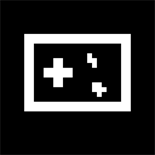

<p align="center">
  
</p>

<h1 align="center">GKME-Web</h1>

<p align="center">
  <strong>G</strong>amepad <strong>K</strong>eyboard <strong>M</strong>ouse <strong>E</strong>mulator — 网页手柄<br/>
  GKME 家族中的浏览器控制器端
</p>

<p align="center">
  <a href="LICENSE"></a>
</p>

用手机浏览器把手柄虚拟出来：打开电脑端 GKME 提供的「网页手柄」地址，即可把浏览器变成一台虚拟游戏手柄，无需安装 App、无需数据线。

- 💬 软件 QQ 群：**639317971**
- 🖥️ 配合电脑端使用：[GKME-Windows](../GKME-Windows)（内嵌 HTTP + WebSocket 服务，负责托管本项目）
- 📱 Android 端与整体项目：[GKME](../GKME)

## 目录

- [功能特性](#功能特性)
- [工作原理](#工作原理)
- [快速上手](#快速上手)
- [部署与集成](#部署与集成)
- [系统要求](#系统要求)
- [项目结构](#项目结构)
- [开源协议](#开源协议)

---

## 功能特性

### 🔌 连接

| 功能 | 说明 |
|------|------|
| **网页直连** | 浏览器打开电脑端给出的地址即可连接，无需安装任何 App |
| **WebSocket 传输** | 与电脑端内嵌服务建立 WebSocket（同源 `/ws`），复用与 Android 端一致的 protobuf 协议，仅把 UDP 分帧换成了 WebSocket 二进制帧 |
| **自动重连** | 断线后按指数退避自动重连（上限 5 秒） |
| **设备标识与命名** | 首次访问生成并持久化设备 ID 与设备名（`localStorage`），便于电脑端区分多个浏览器 |
| **电量上报** | 经 Battery API 读取并上报电量与充电状态 |

### 🎮 虚拟手柄

| 功能 | 说明 |
|------|------|
| **完整按键** | ABXY、肩键 LB/RB、线性扳机 LT/RT、选择/菜单/主页/分享、左右摇杆按下 (L3/R3)、麦克风静音 |
| **摇杆** | 左/右摇杆，支持触摸板（速度）模式与死区；绘制摇杆帽并显示 L/R 文本 |
| **十字键** | 一体十字键与四向独立方向键 |
| **触摸板** | 手柄触摸板区域 |
| **鼠标板** | 触摸板式鼠标：单击 / 双指 / 三指点击、双击后拖拽、单指移动光标、双指 / 三指滚动，可配置灵敏度、加速度、滑动阈值、滚动灵敏度与方向反转 |
| **鼠标键** | 左键、右键、中键、后退、前进五键（与鼠标板手势键位分开保存，互不干扰） |
| **键盘** | 完整键盘布局（字母 / 数字 / 功能键 / 修饰键 / 方向键等），支持 Shift 上档与自动保持修饰键 |
| **自定义按键盘** | 完整的键盘映射（字母/数字/功能键/修饰键等），支持四向 / 八向模式与 Shift 上档字符 |
| **实体手柄转发** | 经浏览器的 Gamepad API 读取标准映射手柄的按键 / 摇杆 / 扳机并转发 |

#### 鼠标板手势（默认值，可在编辑器中修改）

| 手势 | 默认动作 |
|------|----------|
| 单指轻点 | 左键单击 |
| 双指轻点 | 右键单击 |
| 三指轻点 | 中键单击 |
| 双击后滑动 | 左键拖拽 |
| 单指滑动 | 移动光标 |
| 双指 / 三指滑动 | 滚动 |

鼠标板按「指针速度」计算加速度（与触控采样率、发送间隔无关）；双击判定窗口 200 ms，滑动判定阈值默认 4 px。网页端走 WebSocket，等同于 Android 的 Wi-Fi / USB 连接，滚动量按 120 计数单位下发（蓝牙为 1 计数单位）。

### 🎨 布局与外观

| 功能 | 说明 |
|------|------|
| **布局自定义** | 拖拽调整位置和大小，编辑网格仅在拖拽/缩放时淡入淡出 |
| **布局预设** | 内置「完整控制器 / 键盘 / 鼠标」三套布局，可新建、编辑、复制、重命名、删除、恢复默认，带图形化预览卡片，预设可导出 / 导入 JSON |
| **按键样式** | Xbox / PlayStation / Nintendo Switch 三种样式 |
| **描边粗细** | 控件描边使用实际屏幕像素（对齐 Android） |

### ⚡ 触觉与设置

| 功能 | 说明 |
|------|------|
| **按键震动** | 按下 / 松开可分别配置震动，支持自定义时长 |
| **游戏震动** | 可映射到手机马达（[Vibration API](https://developer.mozilla.org/docs/Web/API/Vibration_API)）或实体手柄马达（Gamepad API `dual-rumble`），支持交换左右马达 |
| **轮询率** | 30–1000 Hz 可选 |
| **保持屏幕常亮** | 经 Screen Wake Lock API 让屏幕保持常亮 |
| **息屏模式（近似）** | 用遮罩近似 Android 的息屏模式 |
| **重置** | 一键重置全部设置或当前预设 |

### 📲 作为 PWA

| 功能 | 说明 |
|------|------|
| **添加到主屏幕** | 提供 `manifest.webmanifest`，`display: standalone` |
| **强制横屏** | 清单声明 `orientation: landscape`，iOS 上以 CSS 旋转强制横屏并给出全屏提示 |
| **应用图标** | 192 / 512 图标及 Apple Touch Icon |

---

## 工作原理

浏览器被电脑端当作一个 GKME「控制器设备」：

1. 电脑端 GKME 启动内嵌 HTTP + WebSocket 服务，托管本项目静态文件并给出访问地址（默认端口 `37285`）；
2. 浏览器加载页面后向同源 `/ws?id=…&name=…` 发起 WebSocket 连接；
3. 握手时发送 `Hello`，随后持续上行 `GamepadInput`；
4. 每个二进制帧为 `[1 字节类型][protobuf 负载]`，类型常量与 Android 端 UDP 传输一致；
5. 电脑端把 `Vibration`、`LED`、`TestTone` 等消息下行回浏览器，驱动触觉反馈。

protobuf 定义来自电脑端的 `proto/gamepad_state.proto`，在浏览器侧由 `js/proto.js` 手工编解码。

---

## 快速上手

1. 在电脑上运行 GKME（Windows 端），启动服务；
2. 查看界面中显示的「网页手柄」地址（形如 `http://192.168.x.x:37285/`）；
3. 手机与电脑连入同一局域网，用手机浏览器打开该地址；
4. 点击「连接 / 进入全屏」，即可开始操控。建议横屏使用以获得完整布局。

> 首次连接需手动点击；页面会显示连接状态与字节统计。

---

## 部署与集成

本项目是**纯静态、零构建、零依赖**的前端：直接托管 `index.html`、`css/`、`js/`、`assets/` 与 `manifest.webmanifest` 即可。但它依赖电脑端提供的同源 WebSocket 桥接服务，因此常规用法是与 [GKME-Windows](../GKME-Windows) 一同使用。

- **随电脑端打包**：`GKME.csproj` 会把本项目复制到输出的 `web\` 目录，由内嵌 `WebServer` 托管；
- **开发调试**：`WebServer` 也会在开发目录下向上查找同级 `GKME-Web` 目录；
- **本地预览**：可用任意静态服务器打开页面查看界面，但连接功能需电脑端服务。

---

## 系统要求

| 项目 | 要求 |
|------|------|
| 浏览器 | 支持 WebSocket 与 ES Modules 的现代移动浏览器（Chrome / Edge / Safari 等） |
| 手柄 | 支持 WebSocket 的本机电脑，运行 GKME 电脑端 |
| 屏幕方向 | 建议横屏；iOS 全屏需「添加到主屏幕」 |
| 震动 | 手机马达需浏览器支持 Vibration API（多见于移动端）；实体手柄马达需 Gamepad API 暴露 `vibrationActuator` |
| 保持常亮 | 需浏览器支持 Screen Wake Lock API |

---

## 项目结构

```
GKME-Web/
├── index.html              # 入口页面（画布、连接遮罩、设置面板、编辑浮窗）
├── manifest.webmanifest    # PWA 清单
├── css/
│   └── style.css           # 全部样式
├── js/
│   ├── app.js              # 应用控制器：串联连接、布局、输入、触觉与设置
│   ├── protocol.js         # WebSocket 传输与设备标识
│   ├── proto.js            # protobuf 手工编解码
│   ├── controls.js         # 控件目录、HID 码与标签映射
│   ├── layout.js           # 布局引擎与渲染（核心）
│   ├── editor.js           # 布局编辑器
│   ├── presets.js          # 内置布局预设
│   ├── state.js            # 设置与预设持久化
│   ├── settings-pages.js   # 设置页构建
│   ├── haptics.js          # Vibration / Gamepad 触觉
│   ├── dialog.js           # 弹窗
│   ├── dom.js              # DOM 辅助
│   ├── icons.js            # 图标
│   └── orientation.js      # 屏幕方向与全屏
└── assets/                 # 图标与图片
```

---

## 开源协议

本项目基于 [GNU General Public License v3.0](LICENSE) 发布。
